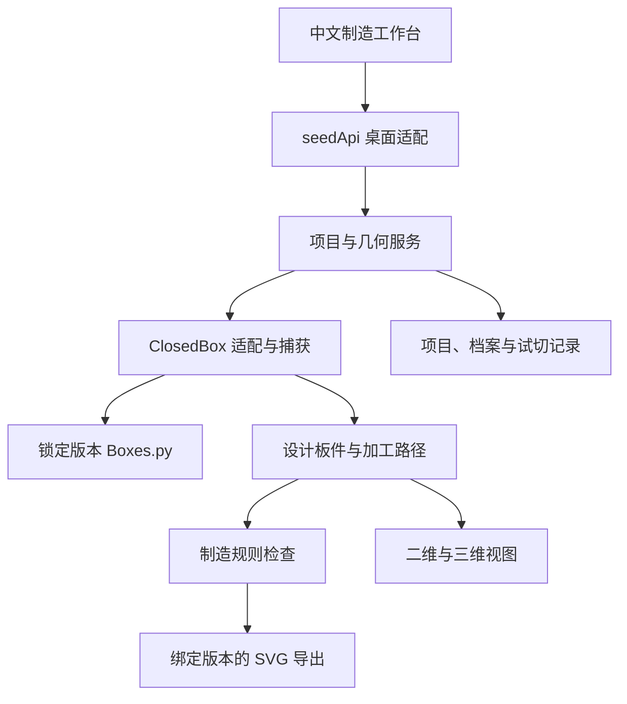

# SeedBoxes 制造闭环与三维设计升级 Implementation Plan

> **For agentic workers:** REQUIRED SUB-SKILL: Use superpowers:executing-plans to implement this plan task-by-task. 如果用户另外指定独立子代理实施与审核，可使用 superpowers:subagent-driven-development。Steps use checkbox (`- [ ]`) syntax for tracking。本交付仅包含开发方案，不代表开始实施或已完成测试。

**Goal:** 将 SeedBoxes 从参数化二维出图客户端，升级为可校准、可定位制造问题、可保存工程，并逐步提供真实板件三维装配与逐面编辑的离线激光设计工具。

**Architecture:** 保留 PyWebView＋Python＋Boxes.py，建立桌面接口适配、生成器适配和统一板件模型。Python 负责权威制造几何与校验，前端负责交互、二维视图和 Three.js 三维显示；设计轮廓与切割路径具有同一项目来源，但分别保留不同制造语义。

**Tech Stack:** Windows 10/11；基线 Python >=3.10,<3.11；uv；锁定 Boxes.py release-1.2 对应提交；PyWebView/WebView2；原生 JavaScript ES Modules 与现有 CSS；后续 Three.js；Python 标准库 dataclasses/JSON；复用经依赖锁核对的 Shapely；pytest 作为开发依赖。首期不引入 Electron、React、云数据库或浏览器 Python 运行时。

**Spec:** 本文第一至十八章构成产品与技术规格，第十九至二十二章为实施任务与验收计划；完整文档随代码归档到 `docs/superpowers/plans/2026-10-01-seedboxes-manufacturing-upgrade.md`。

- 文档版本：V1.0
- 编制日期：2026-10-01（Asia/Shanghai）
- 适用对象：项目负责人、Codex、Claude Code、前端与几何开发者、试切验收人员。
- 基线仓库：https://github.com/liwlin/SeedBoxes
- 已阅读基线提交：`654303a1654a58a6b734c97d872371bb8a541c26`，提交日期 2026-05-05。
- 已核对上游：Boxes.py `release-1.2`，本次拉取解析为 `9d93cd81b05d6ef5b0f3d4b4d6ed7eaf5bbed0dd`。
- 证据范围：源代码静态检查、公开网页与前端产物分析；尚未完成 Windows 运行、性能基准、试切和装配验证。
- 数值口径：本文明确标为“工程初值”“产品限制”“测试样本”的数值是研发决策，不是材料物理定律或已测性能。

## Global Constraints

1. 中文界面、中文交付文档；代码标识、接口、提交信息使用英文。
2. 运行时完全离线；字体、图标、三维库均随应用打包，不依赖 CDN。
3. 保留旧生成器二维使用方式和现有中文翻译，不承诺 179 个生成器全部获得三维能力。
4. 不修改上游 Boxes.py 源码，不把上游源码作为自有代码复制进仓库；定制放在客户端适配层。
5. 当前保留 PyWebView。几何服务不得导入 `webview`，前端业务不得散布 `window.pywebview.api` 调用。
6. 采用统一项目与稳定板件身份；禁止前端另算一套近似卡榫，作为制造正确性的依据。
7. `physicalKerfMm`、`boxesBurnMm`、`jointClearanceMm` 分开存储，禁止混用或重复补偿。
8. 正式导出绑定不可变的几何结果和校验报告；参数修改后必须重新校验。
9. 真机未验证时，界面及报告不得标成“已试切验证”“保证可装配”。
10. 开发不得顺带升级 Python 大版本、替换所有 UI 技术栈或迁移 Electron。
11. 保持仓库已有许可文件与依赖归属说明；不可将可下载的第三方网站压缩代码直接当作自己的实现来源。
12. 用户当前只要求完整方案；执行、发布和实体加工是后续任务。

## Review Focus

- 旧锁文件引用本机路径，导致“开发机正常、干净环境失败”：由 T01 验证独立安装与依赖来源。
- 参数变化、异步结果、板件身份漂移导致孔洞落到另一片板：由 T03、T06、T08 覆盖身份与版本测试。
- 重复补偿、内外轮廓方向错误、标签被当切割路径：由 T04、T07、T09 覆盖制造路径与操作类型。
- 用户改小尺寸、轮廓接近边界、旧工程或损坏文件：由 T05、T08、T09 覆盖拒绝、恢复和定位。
- 数学接触被误报碰撞，或动画穿模被误称可装配：由 T12、T13 区分静态接触、干涉和装配路径验证。

---

## 一、开发目标与优先级

### 1.1 产品定位

SeedBoxes 面向种子创客工坊和学校创客课堂，服务“选盒型—填尺寸—放电子元件—生成板件—校准—切割—装配”的工作流程。核心目标依次是：

1. 真正切得出来：文件尺寸、轮廓、加工类型、补偿语义正确。
2. 装得上：板厚、卡榫与孔位有可信来源，可通过校准和实物验证。
3. 用得顺：实时反馈、错误定位、工程恢复、中文说明。
4. 看得懂：三维装配、爆炸图、板件编号和教学视图。
5. 再扩展：电子盒模板、更多生成器、排版与成本。

界面现代化随功能交付推进，不单独占用第一阶段去重做全部画廊。

### 1.2 首个可交付产品

**V0.2 制造闭环 MVP**：针对一个明确范围的 ClosedBox，提供稳定的六板身份、机器材料档案、配合校准卡、最小圆孔/矩形孔特征、二维检查与定位、工程文件保存、严格对应检查结果的 SVG 导出，以及人工试切记录。

最小开孔提前纳入 V0.2，是为了使“孔离边缘/榫齿太近”的规则可以实际被触发和验收；首版只支持选板后用数字输入定位，不做自由曲线或完整绘图软件。

### 1.3 明确不在首版的功能

- 任意 SVG 自动反推装配、任意 STL 自动拆板。
- 全部 179 个生成器的三维或面编辑。
- 自由斜面、倒角、多面体、活铰链变形、齿轮运动。
- 完整装配路径搜索、有限元、强度保证。
- 异形最优套料、余料自动识别、准确切割工时报价。
- 云账号、协作、商业支付、在线版和 Pyodide。
- 激光机直连与自动发起加工。
- Electron 迁移及 macOS/Linux 正式发行。

## 二、已确认的代码事实与需要先修复的基础

### 2.1 SeedBoxes 基线

| 位置 | 当前责任 | 本次升级处理 |
|---|---|---|
| `app.py` | 窗口、图标、启动、注入 API | 保留；新增启动检查与关闭清理 |
| `backend.py` | 翻译、生成器发现、参数表单、缩略图、渲染、保存对话框 | 保留兼容入口；逐步抽出几何与桌面职责 |
| `web/app.js` | 画廊、参数表单、预览、保存 | 保留旧模式；新模式通过 `seedApi` 接口 |
| `web/index.html` / `styles.css` | 页面与现有安全策略 | 增量加入制造工作台，不全面重写 |
| `SeedBoxes.spec` | Python/资源打包 | 扩展本地前端依赖、字体、规则资源 |
| `pyproject.toml` | Python 范围、Boxes.py Git 依赖 | 精确锁定与锁文件对齐 |
| `uv.lock` | 依赖解析结果 | 本次检查发现仍指向 `../boxes-1.2/boxes-master`，必须先修复 |

`preview()` 并非数学意义的纯函数：它依赖注册表、生成器类状态、渲染环境和锁。当前 `Api._render_lock` 是实例锁；缩略图缓存另有锁，不能把现有锁等同于全进程所有生成路径已经统一串行。

### 2.2 Boxes.py 的可利用基础

- `Surface.parts`、`Part.pathes` 提供二维路径分组，但不是完整的装配模型。
- `rectangularWall()` 等高层调用提供尺寸、边类型、标签与回调入口。
- `move()` 内含平面移动、镜像、旋转与分组边界；捕获必须保留这些变换。
- `ClosedBox.render()` 有明确的六面调用与边型配置，可以编写专用适配器。
- `burn` 参与绘图和间距等计算；不能对输出 SVG 再盲目做一次全局轮廓补偿。
- 导出中的参考框、文字、加工线有不同语义；不能仅依赖线条颜色猜测。

### 2.3 开发前置检查

T01 必须在干净目录完成 `uv lock`、`uv sync --locked` 与源依赖检查，证明不依赖旧的相邻目录。新锁文件变化需人工可读地解释，不顺带全面升级间接依赖。

先在 Windows 确认当前运行基线、WebView2 可用性、传统 SVG 导出。Python 3.10 是兼容起点，后续运行时升级另立任务，不与几何改造混做。

## 三、架构决策记录

| 编号 | 决策 | 理由与约束 |
|---|---|---|
| ADR-01 | 保留 PyWebView | 当前目标不依赖换壳，避免同时改通信、发布和几何 |
| ADR-02 | 采用桌面 API 适配层 | 将来可接 Electron 或 Web，不改前端业务 |
| ADR-03 | Python 是制造几何权威 | 三维只消费板件轮廓与装配变换 |
| ADR-04 | 按生成器适配，先 ClosedBox | 稳定语义比盲目通用推断可靠 |
| ADR-05 | 捕获高层调用＋底层路径 | 同时保留板件语义和真实路径，不修改上游 |
| ADR-06 | 设计轮廓与刀路双表示 | 一个是理想设计，一个是经过补偿的加工中心线 |
| ADR-07 | 项目保存到可迁移文件 | localStorage 仅适合偏好/恢复，不作为工程唯一副本 |
| ADR-08 | 新制造模式首期只承诺 SVG | 避免新增特征在旧格式出口中被静默遗漏 |
| ADR-09 | 传统模式兼容保留 | 尚未适配的模板保持原功能并标注能力 |
| ADR-10 | 先按外接矩形排版 | 首期保证能放下、间距正确，之后再做真实轮廓套料 |

Electron 重新评估触发条件：明确跨平台需求；目标机房出现可复现的 WebView2 兼容成本；多窗口工作区确有需要；同场景测量证明迁移收益。React/Vue、Three.js 并不是换 Electron 的前提。

## 四、目标系统结构与文件职责



建议增量目录：

```text
app.py                           现有启动，增加能力检测/清理
backend.py                       兼容旧 Api，组合新服务
seedboxes/
  domain/
    models.py                    项目、板件、结果、问题等 dataclasses
    serialization.py             JSON 编解码、有限数校验、稳定哈希
  engine/
    registry.py                  适配器注册和能力描述
    capture.py                   调用及路径捕获，二维变换归一
    paths.py                     路径解析、曲线离散、环分类
    adapter_base.py              GeneratorAdapter 协议
    closed_box.py                ClosedBox 专用身份/接合/变换
    bridge.py                    调用 Boxes.py 的唯一入口
    geometry_service.py          两种几何表示和结果缓存
    scheduler.py                 单活动任务/单最新等待任务
  manufacturing/
    profiles.py                  机器、材料、工艺档案
    calibration.py               校准卡与结果回填
    features.py                  孔洞、后续文字等特征
    rules.py                     制造校验规则
    layout.py                    板材布局、边界与间距
    svg_export.py                导出结果与图层映射
    reports.py                   导出清单和验收记录
  assembly/
    transforms.py                三维坐标约定与矩阵
    collision.py                 后续静态干涉窄相检测
  storage/
    projects.py                  原子保存、备份、恢复
    migrations.py                项目格式升级
  desktop/
    api.py                       JSON 桥接方法
    dialogs.py                   文件/目录选择
    capabilities.py              WebView2/格式/三维能力检查
web/
  app.js                         保留传统导航与旧模式
  modules/
    api/seed-api.js               所有宿主调用的唯一入口
    store/project-store.js        项目与编辑历史
    jobs/job-client.js            异步任务、版本丢弃与轮询
    editor/manufacturing-view.js  新工作台组合
    editor/panel-view.js          二维板件与问题高亮
    editor/feature-form.js        数字输入的孔洞编辑
    editor/validation-view.js     错误列表与导出状态
    editor/profile-view.js        加工档案表单
    editor/calibration-view.js    校准向导
    editor/project-files.js       工程打开/保存/恢复
    three/assembly-view.js        后续 Three.js 装配
    three/camera-controls.js      相机与选板
  vendor/                        经确认许可的本地前端库
  fonts/                         经确认可分发的字体资源
resources/
  capabilities.json              模板能力声明
  manufacturing-rules.json        规则阈值与版本
  template-manifests/             后续电子元件模板
  font-manifest.json              后续字体归属及哈希
schemas/
  project.schema.json            工程格式契约
  generated-model.schema.json    生成结果契约
  issue.schema.json              校验结果契约
  profile.schema.json            加工档案契约
  job.schema.json                异步任务契约
  response.schema.json           API 成功/失败封装
scripts/
  verify_baseline.py              干净环境基线与依赖证据
  benchmark_geometry.py          几何性能基准
  vendor_frontend.py              后续固定前端资源及校验哈希
  validate_contracts.py           示例数据与 Schema 一致性
  validate_capabilities.py        能力清单与适配器一致性
  build_preview_fixtures.py       前端无宿主预览的固定测试数据
  verify_release.py              打包资源/版本/输出验证
  measure_webview.py              目标 Windows WebView 帧率/桥接测量
  verify_asset_manifest.py        发布资源清单校验
  geometry_diff.py                几何语义对比
tests/                           自动与人工验收
  fixtures/                      固定输入、轮廓、错误样本
  manual/                        机房与试切操作表
```

不要求一次性建立所有空文件。每个文件随所属任务创建；不把新的几何、规则、存储全部堆回 `backend.py`。

## 五、首版支持范围和能力分级

### 5.1 ClosedBox 产品限制

新制造模式第一版限制为六面闭合、直角指接、矩形量体；禁用螺栓孔扩展、特殊边缘组合和用户任意修改边型。采用实测材料厚度；内外尺寸切换可以支持，但必须由适配器先转换到统一名义尺寸模型。

- 工程初值：内部宽 120 mm、深 80 mm、高 60 mm，材料厚度字段先显示未校准默认值 3 mm。
- 允许输入范围：各维度 20–1000 mm；实测板厚 0.5–20 mm。属于产品输入边界，不代表范围内所有组合可制造。
- 指接边的齿数和空间还需通过独立几何检查；失败时明确指出限制，不静默修成另一个设计。
- 首期校验曲线离散的最大弦误差目标 0.02 mm，数值比较容差 0.001 mm。临界判断须记录误差余量，不把近阈值结果伪装精确。
- 默认按毫米计算；工程文件固定 `units: "mm"`；角度在 JSON 使用度；矩阵使用明确的列主序。

### 5.2 模板能力声明

```json
{
  "generatorId": "ClosedBox",
  "adapterVersion": "1.0.0",
  "capabilities": {
    "legacy2d": true,
    "structuredPanels": true,
    "manufacturingChecks": true,
    "assembly3d": false,
    "faceFeatures": ["circleHole", "rectHole"],
    "enhancedExportFormats": ["svg"]
  }
}
```

三维阶段通过验收后再把 `assembly3d` 改为 true。未适配模板显示“传统二维生成”，不显示“已校验”。统计数量必须根据运行时成功发现的生成器计算，179 只是已读 README 的基线说明。

## 六、统一数据契约

所有字段用英文；所有输入数值必须有限，禁止 NaN、Infinity；ID 与用户显示名称分离。内部可用 dataclasses，JSON Schema 作为跨语言公开契约。

### 6.1 Project

| 字段 | 类型与规则 |
|---|---|
| `schemaVersion` | 整数，首版 1；未知更高版本只读并拒绝覆盖 |
| `projectId` | UUID，工程身份 |
| `revision` | 单调递增整数，制造相关修改递增 |
| `name` | 用户名称，1–120 字符 |
| `units` | 固定 `mm` |
| `engine` | `name/version/commit`；记录实际运行的 Boxes.py |
| `adapter` | `id/version`；如 `closed-box/1.0.0` |
| `generatorId` | 如 `ClosedBox` |
| `parameters` | 规范化生成器参数，不包含输出路径 |
| `profileSnapshot` | 当时使用的材料、机器、工艺完整快照 |
| `features` | 绑定稳定 `panelId` 的特征列表 |
| `layout` | 板材尺寸、边距、间距、旋转策略及位置 |
| `validationPolicy` | 规则集版本、阈值与警告确认记录 |
| `calibrationRef` | 可空，校准记录 ID＋记录快照哈希 |
| `trialRecords` | 实物加工与装配记录，不等于软件自动合格 |
| `createdAt/updatedAt` | ISO 8601；显示按本地时区 |

相机、缩放、选板属于 `viewState`，可单独持久化，不必递增制造 revision，也不使制造校验过期。

### 6.2 Panel 与 AssemblyTransform

稳定 ID 固定为 `front/back/left/right/top/bottom`；A–F 是显示码，分别对应上述顺序。实际源调用映射写在 ClosedBox 适配器中，通过几何与标签验证，不依赖 SVG 中第几个 `<g>`。

每片板包含：

```text
Panel:
  panelId, displayCode, label, thicknessMm
  nominalGeometry: { outer: Path2D, holes: Path2D[], engravings: Path2D[] }
  cutGeometry: { operations: ToolpathOperation[] }
  localFrame: { originRule, uAxis, vAxis, normal }
  assemblyTransform: { matrixColumnMajor: number[16], conventionVersion: 1 }
  layoutTransform: { sheetId, xMm, yMm, rotationDeg, mirrored: false }
  joints: JointRef[]
  provenance: { generatorId, adapterVersion, sourceRole, inputHash }
```

`Path2D` 使用 `M/L/C/Q/A/Z` 的显式命令数组；每条路径有稳定 pathId、closed、operation。检测/三角化可派生为离散多边形，导出优先保留解析曲线。外环与孔环必须明确区分，不能只靠顺逆时针推断。

三维采用右手系：X 向右、Y 向上、Z 向前。各面局部坐标采用右手基 `(u,v,n)`，`n` 是外法线。局部 `(u,v,0)` 位于该板内表面，材料占据局部法向 `[0, thicknessMm]`。局部原点与显示“左下”关系由适配器明确给出；内侧观察时 UI 可以翻转观察方向，但不可悄悄镜像制造坐标。

所有面矩阵必须通过以下测试：基向量正交、行列式为正、内表面位于指定内腔边界、厚度向外扩展。试验项目里不得靠“看起来没问题”的欧拉角猜测坐标。

### 6.3 JointRef

字段：`jointId/panelId/edgeId/matePanelId/mateEdgeId/type/intervals/nominalClearanceMm`。区分凸榫、配对凹槽、普通接触边。ClosedBox 的边类型和相位源自上游实际调用；不得把所有 f/F 组合默认看成任意可互换。

接合区用于最小齿宽、孔到榫根间距与静态干涉提示。不能简单把整个接合包围盒设为“忽略碰撞区”。

### 6.4 Feature

首版 `circleHole` 和 `rectHole`：

```json
{
  "featureId": "<uuid>",
  "panelId": "front",
  "kind": "circleHole",
  "operation": "cut",
  "anchor": {"mode": "absolute", "xMm": 30, "yMm": 25},
  "parameters": {"diameterMm": 8},
  "rotationDeg": 0,
  "enabled": true
}
```

首版只支持板件局部坐标绝对定位；缩小板后孔越界必须报错，不自动缩放、移动或删除。后续新增“距边/居中/比例”锚点时版本化迁移，保持原 absolute 行为。

`disabled` 特征不参与几何，但保留在项目。重复/相交孔首版拒绝导出并要求调整；不要无提示做布尔合并改变结构。

### 6.5 GeneratedModel 与 ValidationIssue

```text
GeneratedModel:
  generationId, projectId, revision, inputHash, engineFingerprint
  adapterVersion, units, panels[], sheets[], diagnostics[], generatedAt
  geometries: { nominal: true, compensatedToolpaths: true }

ValidationIssue:
  issueId, ruleId, severity(error|warning|info), category
  panelId?, featureId?, pathIds[], sheetId?
  messageZh, measuredValue?, thresholdValue?, unit?
  geometryLocation: { coordinateSpace(panel|sheet), point?, bounds?, paths? }
  suggestedActionZh, evidenceKind(analytic|sampled|configuration)

ValidationReport:
  generationId, inputHash, ruleSetVersion, status(pass|warning|error|incomplete)
  issues[], coverage[], skippedChecks[], createdAt
```

`coverage` 必须明确哪些检查已执行；不支持的装配/强度检查显示“未执行”，不显示通过。

### 6.6 版本哈希与数值精度

`inputHash` 由规范化项目制造字段＋引擎提交＋适配器版本＋规则版本计算 SHA-256；排除时间戳、相机与名称等不影响制造几何的字段。处理 -0 和浮点格式，固定序列化排序。内部不为显示目的提前取整；显示取两位不意味着几何只保留两位。

导出必须同时校验 projectId、revision、inputHash 和 generationId；只检查 revision 不足以防止另一工程同 revision 混入。

## 七、捕获与权威几何生成方案

### 7.1 捕获顺序

1. 解析和校验项目参数，获得规范化参数与支持能力。
2. 创建客户端的 ClosedBox 子类/组合适配实例；不改变上游全局方法。
3. 在高层墙板调用边界记录板件角色、尺寸、边类型和进入时二维变换。
4. 让上游原方法完成实际绘制；保存其路径片段、回调产生的孔和操作语义。
5. 将路径从画布坐标逆变换到板件局部坐标，单独保留排版位置。
6. 去除非加工参考内容对板件拓扑的干扰，但不静默吞掉未知加工路径。
7. 赋予稳定 ID、接合关系和三维矩阵，生成结构化结果。

实际捕获入口需要 T03 小原型验证。`open()` 会创建 Surface/context 并可能画参考框，不能在绘制后随意替换 Surface。优先包装当前实例的格式工厂或高层方法；如确需替代 Surface，实现同一协议并保存完整语义，不更改上游文件。

### 7.2 名义几何与补偿刀路

首版针对 ClosedBox 采用“同一适配器、同一参数和同一特征集的两次受控生成”：

- 名义通道：`burn=0`，关闭 QR/参考框/非制造标签，提取设计板件及用于装配的名义轮廓。
- 制造通道：使用已选 `boxesBurnMm` 及明确的内角策略，由 Boxes.py 生成一次补偿后的切割路径。
- 两通道共用稳定板件身份；分别归一化坐标。不能假设两次生成的排版偏移一样，因为 burn 会影响 spacing。
- 对校准卡和新增特征同样遵循该规则，尽量通过上游孔洞 API/回调生成，避免新增孔另走未验证的补偿机制。
- 禁止对制造通道的已有路径再次全局 offset。

**重要门槛**：`burn=0` 仅是获取名义轮廓的候选实现，不自动保证没有上游内角修饰或路径优化。T04 必须对直线、圆孔、凸凹榫、内外尺寸模式核对解析目标尺寸。如无法成立，应在专用适配器内记录补偿前基元来构建名义轮廓；不得用“对已补偿 SVG 反向 offset”掩盖问题。

三维显示的是名义设计，不表示对真实切割锥度、材料收缩、焦点变化的模拟。制造验证依赖档案和试切记录。

### 7.3 首版参数白名单

制造模式允许尺寸、inside/outside 语义、实测 thickness、已验证的 FingerJoint 参数子集、burn、经过验证的 inner_corners 策略。首版不开放上游所有低层开关。传统模式仍显示原表单，增强模式显示其支持范围。

未支持参数不得默默忽略：导入工程遇到它时，要么回传统模式，要么报出具体参数并暂停增强导出。

## 八、机器、材料与工艺档案

### 8.1 数据结构

`ProcessProfile` 包含：

- `profileId/version/name/status`，status 为 `reference/calibrated/retired`。
- machine：用户命名、型号、激光类型、额定功率（可空）、镜头/光学配置备注。
- material：椴木板/亚克力/密度板/自定义，供应商、批次、名义厚度、实测最小/最大/代表厚度。
- process：速度值＋显式单位 `mm/s|mm/min`，功率百分比、次数、焦点备注、气辅状态与可选压力、加工面备注。
- compensation：`physicalKerfMm?`、`boxesBurnMm?`、`jointClearanceMm`、来源 `reference|measured|fitTest`。
- machineBed：有效宽高、不可加工边距；用户可以缩小有效范围。
- rules：最小齿宽、最小剩余连接宽、孔边距等可选阈值和来源。
- evidence：校准日期、试切卡哈希、用户、结果描述、可选照片引用。

### 8.2 首版默认值策略

内置三种材料名称和说明，但不伪造“这台机器切这种板一定适用”的速度、功率或 kerf 数值。无校准时：

- 档案标“未校准”；加工参数允许手填。
- Boxes.py 默认 burn 可显示为“引擎默认参考值”，不是实测值。
- 缺失工艺阈值则对应检查标 `skipped`，整体为 `incomplete`，不能显示全检通过。
- 用户可以明确选择“实验导出”，输出带未完成项的报告；文件拓扑错误、超板材等硬错误仍不能绕过。

已校准档案被修改机器、材料批次、厚度或加工条件后，派生新版本并降为待复核。旧项目的 profileSnapshot 不随全局档案更新自动变化。

### 8.3 拟定规则阈值

演示工程可附带一组标为“示例”的阈值用于软件测试。正式材料阈值由试切建立，不能把比例公式作为通用强度标准。使用绝对毫米阈值，后续可增加“板厚倍数”输入，但保存时记录表达式和解析结果。

## 九、校准卡：分清测量与配合

### 9.1 配合试切卡先做

目的：确定特定机器、材料和参数下，实际装配合适的 Boxes.py burn 值。校准卡使用与目标盒相同的板厚、指接设置和边生成逻辑。

- 用户输入起始 burn、步长、样本数；全部候选值显示清楚。
- 工程初值：起点 0.00 mm，步长 0.02 mm，11 档，到 0.20 mm；允许修改。这是试验扫描初值，不是材料推荐值。
- 输入限制：2–21 档；步长大于 0；候选 burn 在首版支持范围 0–1 mm。超范围拒绝生成。
- 每档生成一对有明确配对编号的指接样件，确保双方采用该档同一补偿方案。
- 标签如 `B05 / burn=0.08 mm`；标签放入雕刻/参考操作，默认不混入切割路径。
- 保留取件连接条如需实现则单列工艺特征；首版不隐式添加。
- 用户逐档记录 `loose/slipFit/pressFit/tooTight/broken/notTested`，选中目标用途对应的结果。
- 回填的是 `boxesBurnMm`，不会擅自将它乘二当作测得物理切缝。

试切卡生成、导出、结果回填都绑定档案快照哈希。不能拿另一厚度或机器条件的结果自动标记校准。

### 9.2 物理切缝测量卡后做

通过未补偿的已知尺寸孔/塞块或多切口试样与卡尺读数估算 physicalKerfMm。几何模型、测量方法及误差应独立说明。`physicalKerfMm / 2` 最多是某些路径偏移模型的起点，不作为本项目对 Boxes.py burn 的无条件转换公式。

### 9.3 配合间隙

`jointClearanceMm` 表示设计层的额外装配余量，与机器补偿分开。首版固定为 0 且字段保留，避免让用户同时调两个变量无法判断原因。开放此功能前，须验证对配对凸凹几何的作用并加入独立测试。

## 十、制造体检规则与导出策略

### 10.1 规则目录

| Rule ID | 条件与算法口径 | 等级/处理 |
|---|---|---|
| INPUT_NONFINITE | NaN、Infinity、非法字符串、尺寸越界 | error，阻断 |
| ADAPTER_UNSUPPORTED | 未支持参数/边型、板件身份不完整 | error，阻断增强导出 |
| CUT_OPEN_CONTOUR | 要求闭合的外轮廓/孔无法闭合；雕刻开放线不触发 | error，阻断 |
| CUT_SELF_INTERSECTION | 外环/孔环自交，无法明确形成材料区域 | error，阻断 |
| CUT_DUPLICATE_PATH | 几何容差内重复的切割路径 | error，阻断，防重复烧切 |
| FEATURE_OUTSIDE_PANEL | 孔不在可用材料区域内或越过外轮廓 | error，阻断 |
| FEATURE_OVERLAP | 首版孔洞相交/重叠导致含义不明确 | error，阻断；后续显式布尔合并 |
| PANEL_OUTSIDE_SHEET | 制造路径越过可加工区域，含边距 | error，阻断 |
| PANEL_LAYOUT_OVERLAP | 板件材料区域重叠或违反指定排版间距 | error，阻断 |
| HOLE_EDGE_CLEARANCE | 孔边界到非接合外边界的最小材料距离低于阈值 | warning，定位并说明 |
| HOLE_JOINT_CLEARANCE | 孔到榫根/槽根区域的距离低于阈值 | warning；穿透则 error |
| JOINT_TOOTH_TOO_THIN | 指接最小有效齿宽低于阈值 | warning；零宽/退化为 error |
| MATERIAL_WEB_TOO_THIN | 两孔之间或孔与轮廓之间剩余连接宽低于阈值 | warning |
| PROFILE_UNCALIBRATED | 档案无匹配有效试切证据 | warning |
| RULE_THRESHOLD_MISSING | 必需工艺阈值未配置 | incomplete，不冒充通过 |
| ASSET_UNAVAILABLE | 文字轮廓或必要资源缺失 | 无可用轮廓时 error；仅缺字体编辑能力为 warning |
| ENGINE_VERSION_MISMATCH | 工程与当前引擎/适配器不一致 | warning＋重新生成比较，不复用旧检查 |
| GEOMETRY_STALE | 导出模型与当前工程 hash 不同 | error，要求重新生成 |

### 10.2 几何检查约定

- 名义几何用于孔边距、齿宽与材料连接宽；补偿刀路用于加工边界、重复路径与输出有效性。
- 直线与圆尽量解析计算；曲线离散检测返回 `evidenceKind: sampled` 并记录最大误差。
- 临界值在离散误差范围内时提示“接近阈值，需要复核”，不得武断判为通过。
- 外环、孔环与雕刻操作由捕获来源或特征类型赋值，颜色只用于显示。
- 检查以板件局部几何进行，定位转换到当前二维视图；布局问题用板材坐标。
- 不自动修闭合、自交、过近孔洞。可提供显式修复建议，修改后重生成。

### 10.3 UI 行为

问题列表显示严重度、板件码、问题描述、实测值、阈值、建议操作。点击定位到板件并高亮相关轮廓/区域；返回列表不丢失选中状态。

导出状态：

1. `error`：阻止增强加工导出；允许保存工程和诊断报告。
2. `incomplete`：不允许“已检查导出”；可显式“实验导出”，列明未检查项目。
3. `warning`：逐项或按同规则分组确认，确认记录绑定本次 inputHash。
4. `pass`：允许导出；只表示已实施规则通过，不代表真实装配或强度保证。

用户改参数、加工档案、布局或规则阈值，旧报告立刻标为过期，旧确认失效。

## 十一、项目保存、恢复与兼容

### 11.1 文件与本地目录

首版工程扩展名 `*.seedbox.json`，UTF-8，单文件可迁移。小型字体轮廓后续内嵌，原始字体不默认嵌入。缩略图为可再生成缓存，不必写入首版工程。

Windows 数据默认 `%LOCALAPPDATA%/MakerSeed/SeedBoxes/`：profiles、recovery、logs、recent。正式工程位置由用户选择。

- 原子保存：同目录写临时文件、刷新并关闭、替换正式文件；保留上一版本 `.bak`。
- 自动恢复：编辑停止 2 秒后写恢复文件；恢复失败提示，不覆盖正式工程。
- 正常退出清理已确认同步的恢复项；异常退出下次列出恢复候选。
- 项目 schema 升级先备份；未知新版本只读，禁止静默丢字段后保存。
- 导入首版产品限制 20 MiB，超限给出说明；限制是资源管理选择，可后续调整。
- 日志不记录全部工程轮廓或用户文件内容；记录任务 ID、版本、错误分类。

### 11.2 版本变化

引擎/适配器改变时，保留原参数和原版本声明，生成新结果后展示几何差异摘要（板件数、包围尺寸、孔数量、轮廓变化）。用户保存才写新版本；不把旧工程自动转换后覆盖。

### 11.3 撤销重做

项目参数、特征、布局操作纳入历史；相机旋转不进入制造编辑历史。拖动从按下到释放合并为一次记录；输入框连续输入按一次确认合并。首版最多 100 步，并设置序列化历史大小上限 20 MiB，超过按最旧顺序淘汰并通知。数值为初始产品限制，可测量后调整。

## 十二、异步 API、任务调度和性能

### 12.1 接口封装

前端唯一入口 `web/modules/api/seed-api.js`，公开方法名保持跨宿主稳定：

```text
getCapabilities() -> ApiResponse<Capabilities>
submitGeneration(project: Project) -> ApiResponse<JobTicket>
getJob(jobId: string) -> ApiResponse<JobStatus>
validateGeneration(generationId: string, policy: ValidationPolicy) -> ApiResponse<ValidationReport>
exportGeneration(request: ExportRequest) -> ApiResponse<ExportReceipt>
openProject() -> ApiResponse<Project | Cancelled>
saveProject(project: Project, saveAs: boolean) -> ApiResponse<SaveReceipt | Cancelled>
listProfiles() -> ApiResponse<ProcessProfile[]>
saveProfile(profile: ProcessProfile) -> ApiResponse<ProcessProfile>
generateCalibrationCard(spec: CalibrationSpec) -> ApiResponse<CalibrationDocument>
recordCalibration(result: CalibrationResult) -> ApiResponse<ProcessProfile>
```

Python 桥接可用同名 snake_case 对应，映射只存在于适配文件。统一结果封装 `{ok:true,data:...}` 或 `{ok:false,error:{code,messageZh,retryable,details?}}`。桌面 traceback 进入本地日志，不在用户提示中直接展示。

`ExportRequest` 必须包含 `generationId/projectId/revision/inputHash/reportId/format/acknowledgedIssueIds/experimental`；format 首版为 svg。文件选择取消返回 cancelled，不视为失败。

### 12.2 调度行为

- 输入防抖工程初值 300 ms；开始编辑就标记当前预览为旧版本。
- 单个窗口一个活动渲染＋一个最新待处理快照；新请求覆盖尚未开始的旧请求。
- 已运行的 Boxes.py 调用无法安全中断时，让其结束但丢弃过时结果；不能声称已取消 CPU 工作。
- job 状态为 `queued/running/succeeded/failed/superseded`。
- `requestId/projectId/revision/inputHash` 全部校验，工程切换时不会接纳旧结果。
- 前端轮询工程初值 150 ms，隐藏窗口可降频；完成、关闭页面时停止轮询。
- 所有 Boxes.py 渲染（含缩略图、旧模式、校准卡）共享受控执行入口。缓存命中可快速返回，不绕过必要锁。
- 生成结果 LRU 初值 8 份或估算 64 MiB，以先到者为准；导出持有结果引用直至文件写入结束。
- 长任务显示耗时；10 秒提示“仍在计算”，30 秒标“超出响应目标”。线程方案不得强杀。若需硬超时，再独立引入计算子进程。

### 12.3 性能验收方式

先测现状，再设发布门槛。建议目标而非已证实指标：参考 Windows 机、ClosedBox 六板＋20 个孔，几何生成 P95 <=1 秒；参数稳定到视图更新 P95 <=1.5 秒；三维常规旋转 >=30 FPS。样本为 30 次重复，报告 CPU/GPU/内存、引擎版本、冷启动和热运行分别统计。

若未达到，优先定位曲线离散、重复生成、序列化、DOM/网格重建，再决定 Worker/计算进程或宿主更换。

## 十三、三维装配与教学视图

### 13.1 三维阶段范围

- 本地 Three.js；直接消费 `nominalGeometry` 与 assemblyTransform。
- 外环与孔环三角化后沿局部法向挤出实际厚度。
- 相机旋转、缩放、平移、标准视角、复位。
- 板件选择与二维联动；显示/隐藏/半透明；A–F 标识。
- 爆炸距离滑块；在既定方向移动板件，不更改制造几何。
- 网格与材质替换时 dispose，工程切换后不积累 GPU 资源。
- WebGL 不可用或上下文丢失时保留二维与导出能力，并显示降级原因。

### 13.2 教学动画的边界

初版动画命名“装配示意”，只说明板件位置和建议顺序；不得标“已验证装配路径”。六面卡榫盒可能需要多片同时对齐，不能保证 A–F 逐片直线飞入就是可执行工序。

后续“已验证步骤”需有实物录像/说明记录及适用参数范围。闭合到位仅是静态状态，不等于可达性。

### 13.3 静态干涉检查

先做 broad phase 包围盒，再对相交候选做真实板件实体/网格窄相。接触面与非零体积交叠区分，采用明确公差。配对榫允许表面接触，但不能整个接合区豁免。

隔板、盖子等新结构加入时分开声明：最终位置干涉、盖子开合扫掠、完整装配路径。后两者在对应模块完成前都标未检查。

### 13.4 内侧编号

默认编号为屏幕与参考图层，不进入加工。启用“雕刻编号”后选择加工面。内侧浅雕涉及翻面与镜像，须有板件基准、加工面、定位说明；首期只支持明确的单面加工，不自动生成双面翻板加工流程。

浅雕深度不由 SVG 颜色保证，用户在激光软件设置功率速度。界面写“雕刻编号”，不保证具体深度。

## 十四、逐面编辑与电子项目盒模板

### 14.1 分阶段编辑

V0.2：圆孔、矩形孔，数字输入与板件选择。

V0.4：圆角矩形、孔阵列、旋钮孔、风扇孔、文字雕刻、复制、旋转、对齐、距边/居中锚点。自由贝塞尔曲线、任意 SVG 导入与复杂布尔编辑另立范围。

所有特征先记录参数，再生成几何，不能只修改预览 DOM。保存后重新打开与导出必须保持一致。

### 14.2 模板元数据

每个电子模板包含 `templateId/version/componentModel/sourceUrl/sourceDate/dimensions/clearance/anchor/verificationStatus`。USB 口、船型开关、OLED、风扇都不是单一尺寸；必须按具体器件型号/图纸或实测尺寸建档。

PCB 模板包含孔中心坐标、孔径、板轮廓、安装朝向、接口伸出方向、紧固件信息、下方/上方高度包络。用户填孔距也能生成模板，未核对标“自定义未验证”。

ESP32-S31 主控板模板必须等实际 PCB 版本/机械尺寸，不根据芯片型号猜整板孔位。

### 14.3 文字

文字保存文本、字体资源标识/哈希、尺寸、字距和已经生成的向量轮廓。系统缺字体但有轮廓时允许照原样导出；修改文字前要求恢复字体。字体许可与文件来源记录在资源清单。

首期文字仅雕刻；穿透切字需要处理封闭字腔掉落与桥接，另列模板类型，不自动声称所有中文都可切割成镂空字。

## 十五、更多生成器与课堂模式

### 15.1 接入顺序

ClosedBox → ABox 的受限开口配置 → 经指定盖型验证的基础盒 → 简单分隔盒 → 一个明确电子项目盒。UniversalBox 需要按支持参数子集接入，不因名称相似就标全支持。

每个适配器交付：能力描述、稳定板件 ID、装配坐标、参数支持矩阵、补偿行为测试、至少一个试切记录或明确“未试切”。

动态数量的隔板以语义 ID＋稳定布局键绑定，删除或重排时显式处理孤立特征。不能把数组下标当长期身份。

### 15.2 课堂模式

老师预设材料、工艺、尺寸上限、允许编辑的面与模板；学生仅调整尺寸、文字和选定图案。首版属于交互限制，不是防篡改权限系统。若学校需要真实权限或班级作品提交，应另外设计账号/设备管理。

教学页面保留实物照片/模板图，显示二维与三维能力等级，使用简洁中文解释“内尺寸”“板厚”“配合校准”。

## 十六、排版、余料与成本

### 16.1 首版排版

保留稳定板件，按实际轮廓包围尺寸做 0°/90° 排版；可固定方向以尊重材料纹理。考虑板材边距、夹具禁区（首期用缩小矩形有效区）、板件间距。不承诺最优利用率。

材料利用率至少区分：成品板件净面积/整板面积，排版占用面积/整板面积。孔洞和雕刻不应混进板材消耗口径；显示定义与单位。

### 16.2 后续真实轮廓套料

独立模块，以多边形轮廓和安全间距为输入，支持禁止旋转、允许角度、纹理方向。先保证不相交与可重复，再优化密度；不把“算法运行了”称为最优。

### 16.3 余料与成本

余料记录初期手动矩形尺寸＋材料批次，后续多边形余料。估算区分按整板购入成本、按面积分摊成本、耗材/加工服务费。若没有真实加工时间与路径速度模型，禁止输出貌似精确的机器工时价格。

## 十七、导出一致性与格式边界

### 17.1 首版增强导出

`laserform` 的配色不直接复制成事实标准；SeedBoxes 定义自身图层：`cut_outer/cut_inner/engrave/annotation`，SVG 通过 group id 与元数据标识。颜色只辅助用户在激光软件中映射，需实际导入验收。

- SVG 根元素 `width/height` 带 mm；viewBox 与毫米坐标一致。
- 参考框、警告高亮不进入默认加工图层。
- 注释文件包含项目 hash、引擎/适配版本、材料档案、规则报告摘要。
- 可选择导出 `*.manufacturing.json` 伴随清单，用于追溯；正常课堂使用不强迫学生阅读实现字段。
- 禁止每次保存重新走另一条未应用特征的旧渲染路径。
- 旧模式继续提供现有 SVG/PS/LBRN2 等能力；增强模式没有验证的格式隐藏或明确不支持。

### 17.2 工程导出一致性契约

同一 generationId 的二维预览、校验、SVG 文件必须源自同一结果。导出后解析 SVG，按路径类型、板件 ID、尺寸和孔数量与源结果比对。不能直接对整个 SVG 文本做 golden 比较，因为时间戳和属性排序可能变化。

### 17.3 后续其他格式

LBRN2、DXF、PDF 逐一接入完整增强数据流后才开放；PDF 是查看文档还是可加工向量应明确。外部转换程序缺失时只影响对应格式，不影响 SVG。不可通过“可选格式”让用户导出一个丢孔的文件。

## 十八、发布质量、风险与阶段门槛

### 18.1 自动与人工验收分工

自动化适合：坐标、补偿、板件数、路径拓扑、孔位、版本一致性、异步竞态、文件恢复。

人工适合：目标激光软件导入尺寸、加工图层设置、实际切割质量、配合手感、装配顺序和学生使用体验。自动检查通过不能替代人工试切。

### 18.2 样本矩阵

| 样本 | 内容 | 目的 |
|---|---|---|
| S01 | 内尺寸 120×80×60，t=3，burn=0 | 名义尺寸、六板身份 |
| S02 | 与 S01 相同，burn=0.10 | 刀路变化但名义尺寸保持 |
| S03 | 外尺寸模式，与 S01 匹配内腔 | 内外尺寸转换 |
| S04 | 200×150×100，t=5 | 另一尺度，卡榫与坐标 |
| S05 | 前板圆孔 D=8，中心(30,25) | 特征位置与导出 |
| S06 | 孔移到越界、齿根附近 | error/warning 与定位 |
| S07 | 重复孔、相交孔、开放雕刻 | 操作语义与拒绝策略 |
| S08 | 板材有效区小于某板件 | 超界阻断 |
| S09 | 快速修改 20 次并切换工程 | 异步结果隔离 |
| S10 | 旧版本、未来版本、截断 JSON | 恢复、只读与错误提示 |
| S11 | GPU 不可用、无网络、中文路径 | 桌面环境与降级 |
| S12 | 实际板材厚度变化、工艺变更 | 档案版本和校准失效 |

这些是软件测试数据，不代表已经试切过。

### 18.3 发布门槛

G0：干净环境可复现，传统 ClosedBox 导出不回归。

G1：稳定六板、名义/刀路语义、孔位和局部坐标自动测试通过。

G2：材料档案、校准卡、体检定位、工程恢复和增强 SVG 一致性通过；V0.2 可进入试用，但实际验证状态保持未验证。

G3：在一台指定机器＋一种实际材料＋一组工艺条件下完成校准和盒子试切，记录结果。合格范围只适用于该记录，不推广为全部材料认证。

G4：三维与名义板件一致、GPU 资源与降级验证通过，才开放 V0.3 三维能力。

G5：更多编辑和模板逐个通过参数矩阵与导出测试，才扩大能力清单。

### 18.4 实物验收记录

记录：操作者、日期、机器、材料批次、至少五点厚度测量、工艺参数、卡编号、选用 burn、文件 hash、尺寸实测、松紧评价、破损/烧焦/锥度备注、装配照片、结论。

选用目标配合为滑配还是压配由任务预设决定，不用一个“装得上”覆盖所有用途。出现问题先定位材料/工艺/几何/操作来源，不盲目修改补偿掩盖几何错误。

---

## 十九、实施任务清单（按依赖顺序执行）

以下每个任务应形成独立可检查提交。命令在完成 T01 开发依赖安装后执行；测试文件在对应任务创建。名称是待实现接口，不表示现有代码已经包含。

### T01：修复可复现依赖并建立基线

**Files:** 修改 `pyproject.toml`、`uv.lock`；新增 `scripts/verify_baseline.py`、`tests/test_baseline.py`、`tests/fixtures/baseline/`。

**Interfaces:** 产生 `BaselineManifest(engineCommit, pythonVersion, discoveredGenerators, supportedFormats)`；记录原 ClosedBox/ABox 的规范化 SVG 语义。

- [ ] 写 `test_lock_has_no_local_boxes_source`：断言锁文件无 `../boxes-1.2`；`test_closedbox_baseline_renders`：断言可生成有效毫米 SVG。
- [ ] 运行 `uv run pytest tests/test_baseline.py -q`，确认本地路径测试揭示当前问题；记录失败证据。
- [ ] 将上游依赖锁到本次确认的提交，加入 pytest 开发依赖；重新生成锁文件并审阅差异。
- [ ] 在不含旧相邻目录的新 checkout 执行 `uv sync --locked`，运行 `uv run python scripts/verify_baseline.py` 和上述测试。
- [ ] 提交 `build: make boxes dependency reproducible`。

**完成门槛：** 没有继承旧开发机路径；记录实际生成器数；暂不宣称 179 个全部可渲染。

### T02：建立项目、板件和 API 契约

**Files:** 新增 `seedboxes/domain/models.py`、`serialization.py`；新增 `schemas/*.schema.json` 本期所需文件；新增 `tests/test_contracts.py`、`scripts/validate_contracts.py`。

**Interfaces:** `normalize_project(data: dict) -> Project`；`project_input_hash(project: Project, engine: EngineFingerprint) -> str`；`to_json(value: object) -> dict`。

- [ ] 写 `test_project_round_trip`、`test_reject_nonfinite`、`test_view_state_does_not_change_input_hash`、`test_process_change_changes_hash`。
- [ ] 运行 `uv run pytest tests/test_contracts.py -q`，记录缺失实现的失败。
- [ ] 实现第六章字段、枚举、单位和规范化规则；未知字段按 schemaVersion 策略处理，不静默丢失。
- [ ] 运行上述测试及 `uv run python scripts/validate_contracts.py`，所有样例匹配 Schema。
- [ ] 提交 `feat: define manufacturing project contracts`。

### T03：ClosedBox 高层捕获与稳定身份小原型

**Files:** 新增 `engine/adapter_base.py`、`bridge.py`、`capture.py`、`paths.py`、`closed_box.py`、`registry.py`；新增 `tests/test_closed_box_capture.py`；修改 `backend.py` 仅接入桥接。

**Interfaces:** `GeneratorAdapter.generate(project: Project, mode: Literal["nominal","toolpath"]) -> CapturedModel`；`ClosedBoxAdapter` 实现协议；`CapturedModel` 含板件路径、二维坐标变换、源角色和诊断。

- [ ] 写 `test_six_stable_panel_ids`、`test_resize_preserves_roles`、`test_reference_and_labels_not_panels`、`test_capture_does_not_patch_global_class`。
- [ ] 运行 `uv run pytest tests/test_closed_box_capture.py -q`，确认失败。
- [ ] 用客户端子类/实例包装捕获六次真实绘制；处理仅移动调用与内置二维变换；映射 front/back 等身份。
- [ ] 对 S01/S04 和不同标签设置测试，确认六板相同、局部坐标与上游路径等价；执行 `scripts/geometry_diff.py` 的基础轮廓比较。
- [ ] 提交 `feat: capture structured closed box panels`。

**止损门槛：** 如果一个受限 ClosedBox 都无法可靠对应身份和轮廓，停止扩模板，提交具体失败样例与替代捕获入口；不以任意 SVG 猜测补上。

### T04：建立名义轮廓与一次补偿刀路

**Files:** 新增 `engine/geometry_service.py`；修改 `bridge.py`、`closed_box.py`、`paths.py`；新增 `tests/test_compensation.py`、`scripts/geometry_diff.py`。

**Interfaces:** `GeometryService.generate(project: Project) -> GeneratedModel`；`get_generation(generation_id: str) -> GeneratedModel`；LRU 缓存使用第十二章限制。

- [ ] 写 `test_burn_changes_toolpath_not_nominal`、`test_layout_shift_does_not_change_local_geometry`、`test_inside_outside_equivalence`、`test_hole_compensated_once`。
- [ ] 用 S01/S02/S03 运行 `uv run pytest tests/test_compensation.py -q`，确认缺失实现的失败。
- [ ] 实现受控双通道，验证 burn=0 与内角处理；必要时用补偿前基元记录实现名义通道，保留失败证据。
- [ ] 比较解析宽高/孔径/榫间隔与结果；最大几何误差按本方案容差规则，不把图像相似当通过。
- [ ] 提交 `feat: separate nominal geometry from compensated toolpaths`。

### T05：工程保存、加工档案与版本恢复

**Files:** 新增 `storage/projects.py`、`migrations.py`、`manufacturing/profiles.py`、`desktop/dialogs.py`；新增 `tests/test_project_storage.py`、`test_profiles.py`。

**Interfaces:** `ProjectStore.load(path: Path) -> Project`；`save(project: Project, path: Path) -> SaveReceipt`；`ProfileStore.save(profile: ProcessProfile) -> ProcessProfile`；`list_profiles() -> list[ProcessProfile]`。

- [ ] 写 `test_atomic_save_failure_keeps_previous`、`test_future_schema_is_read_only`、`test_profile_edit_does_not_mutate_project_snapshot`、`test_process_edit_invalidates_calibration`。
- [ ] 运行 `uv run pytest tests/test_project_storage.py tests/test_profiles.py -q`，确认失败。
- [ ] 实现原子写入、备份、中文路径、恢复目录和 schemaVersion 检查；内置材料名称但不伪造加工参数。
- [ ] 测试读写中断、截断 JSON、20 MiB 限制和五点厚度记录；验证全局档案变更不修改旧项目。
- [ ] 提交 `feat: persist projects and versioned process profiles`。

### T06：宿主解耦、实时调度与状态反馈

**Files:** 新增 `engine/scheduler.py`、`desktop/api.py`、`web/modules/api/seed-api.js`、`store/project-store.js`、`jobs/job-client.js`；修改 `backend.py`、`web/app.js`；新增 `tests/test_scheduler.py`、`tests/manual/async-ui.md`。

**Interfaces:** `JobScheduler.submit(project: Project) -> JobTicket`；`status(job_id: str) -> JobStatus`；前端暴露第十二章接口与统一 ApiResponse。

- [ ] 写 `test_only_latest_pending_job_runs`、`test_result_isolated_by_project`、`test_error_does_not_deadlock`、`test_legacy_render_shares_engine_gate`。
- [ ] 运行 `uv run pytest tests/test_scheduler.py -q`，确认失败。
- [ ] 实现单活动/最新等待任务；将传统渲染、缩略图和校准走同一受控桥；前端 300 ms 防抖与 generation 身份检查。
- [ ] 运行测试；手动快速改值 20 次、切项目、引发参数错误，检查不会覆盖新结果、不出现无限任务队列。
- [ ] 提交 `feat: schedule versioned geometry jobs`。

### T07：配合校准卡与档案回填

**Files:** 新增 `manufacturing/calibration.py`、`web/modules/editor/calibration-view.js`；新增 `tests/test_calibration.py`。

**Interfaces:** `generate_fit_card(spec: CalibrationSpec, profile: ProcessProfile) -> CalibrationDocument`；`record_fit_result(result: CalibrationResult) -> ProcessProfile`。CalibrationDocument 含 cardId、候选档位、配对样件、profileHash、补偿口径和导出图层。

- [ ] 写 `test_eleven_candidates_include_endpoints`、`test_labels_are_not_cut`、`test_profile_hash_mismatch_rejected`、`test_fit_result_does_not_invent_physical_kerf`。
- [ ] 运行 `uv run pytest tests/test_calibration.py -q`，确认失败。
- [ ] 使用 Boxes.py 相同指接规则生成两两配对试片；候选 burn 参数及可修改范围按第九章实现。
- [ ] 检查每档刀路只补偿一次、编号可辨、记录回填到新档案版本；实际试切留待 T11。
- [ ] 提交 `feat: add fit calibration cards and traceable results`。

### T08：最小逐面孔洞与项目历史

**Files:** 新增 `manufacturing/features.py`、`web/modules/editor/feature-form.js`；修改 `closed_box.py`、`project-store.js`；新增 `tests/test_features.py`。

**Interfaces:** `validate_feature_input(feature: Feature) -> Feature`；`apply_features(panel: CapturedPanel, features: list[Feature], mode: str, compensation: Compensation) -> CapturedPanel`。若通过回调实现，仍暴露相同业务语义，不让 UI 依赖具体回调。

- [ ] 写 `test_front_hole_stays_front_after_resize`、`test_round_trip_keeps_feature_ids`、`test_shrink_does_not_move_invalid_hole`、`test_nominal_and_toolpath_share_feature_set`。
- [ ] 运行 `uv run pytest tests/test_features.py -q`，确认失败。
- [ ] 实现 circleHole/rectHole 的 absolute 定位、启用禁用、编辑删除；与两通道生成相连。
- [ ] 验证保存重开、撤销重做、孔越界时保留输入且阻断导出；历史按第十一章合并和限制。
- [ ] 提交 `feat: add persistent panel hole features`。

### T09：规则引擎、二维定位与基础排版

**Files:** 新增 `manufacturing/rules.py`、`layout.py`、`resources/manufacturing-rules.json`、`web/modules/editor/panel-view.js`、`validation-view.js`；新增 `tests/test_rules.py`、`test_layout.py`。

**Interfaces:** `validate_model(model: GeneratedModel, policy: ValidationPolicy) -> ValidationReport`；`layout_panels(panels: list[Panel], spec: LayoutSpec) -> list[Sheet]`。

- [ ] 为第十章规则逐一建立小样例；关键测试 `test_open_engraving_allowed`、`test_duplicate_cut_blocked`、`test_missing_threshold_is_incomplete`、`test_issue_location_uses_panel_coordinates`、`test_sheet_margin_respected`。
- [ ] 运行 `uv run pytest tests/test_rules.py tests/test_layout.py -q`，确认失败。
- [ ] 实现拓扑、间距、齿宽、板材范围与重复路径检查；记录 analytic/sampled；0/90 排版支持禁止旋转。
- [ ] UI 点击 issue 定位到板件/路径；对临界误差、缺阈值和旧报告显示正确状态；运行上述测试。
- [ ] 提交 `feat: validate manufacturing geometry with panel locations`。

### T10：版本绑定导出与工作台整合

**Files:** 新增 `manufacturing/svg_export.py`、`reports.py`、`web/modules/editor/manufacturing-view.js`、`profile-view.js`、`project-files.js`；修改 `desktop/api.py`、`web/index.html`、`web/styles.css`；新增 `tests/test_export.py`。

**Interfaces:** `export_svg(model: GeneratedModel, report: ValidationReport, request: ExportRequest) -> ExportPayload`；`ExportPayload` 含 svgBytes、manifestJson；桌面层写文件，纯几何导出层不弹对话框。

- [ ] 写 `test_export_rejects_stale_hash`、`test_feature_survives_export`、`test_annotations_excluded_by_default`、`test_error_cannot_be_acknowledged_away`、`test_mm_size_round_trip`。
- [ ] 运行 `uv run pytest tests/test_export.py -q`，确认失败。
- [ ] 实现生成结果、报告和确认记录绑定；新模式仅开放 SVG；整合三栏工作台和状态条。
- [ ] 导出后重新解析 SVG，对比六板、孔数、路径语义及尺寸；目标激光软件导入检查列入 T11。
- [ ] 提交 `feat: export validated manufacturing snapshots`。

### T11：V0.2 打包、性能与实体闭环验收

**Files:** 修改 `SeedBoxes.spec`、`app.py`、`build_uv.bat`；新增 `scripts/benchmark_geometry.py`、`verify_release.py`、`desktop/capabilities.py`、`tests/manual/windows-release.md`、`tests/manual/physical-trial.md`；更新 README/DEVELOPMENT。

**Interfaces:** `detect_capabilities() -> Capabilities`；基准输出固定 JSON（设备、样本、冷/热时延、失败数）；实体记录写回 Project.trialRecords。

- [ ] 建立缺失资源/离线启动/中文路径验收清单；新能力检测返回明确三态 `available/unavailable/unknown`。
- [ ] 执行全部 V0.2 相关测试和 `uv run python scripts/benchmark_geometry.py`，记录未达标项。
- [ ] 按现有 Windows 打包入口产生测试 exe；离线机器验证启动、恢复、导出、WebView2 缺失提示。
- [ ] 用户或现场人员完成校准卡和 ClosedBox 试切，填写第十八章记录；AI 无法现场加工时明确交接，不伪造通过。
- [ ] 修复有证据的问题，提交 `release: prepare manufacturing mvp validation`；实体门槛通过后才标该档案已验证。

### T12：真实板件三维与二维联动

**Files:** 新增 `assembly/transforms.py`、`web/modules/three/assembly-view.js`、`camera-controls.js`、`scripts/vendor_frontend.py`、`measure_webview.py`；修改资源清单/打包；新增 `tests/test_assembly_transforms.py`、`tests/manual/three-view.md`。

**Interfaces:** `build_assembly_transform(panel_role: str, dimensions: Dimensions, thickness: float) -> Matrix4`；前端 `renderAssembly(model)`、`selectPanel(panelId)`、`disposeAssembly()`。

- [ ] 写 `test_panel_frames_are_right_handed`、`test_thickness_extends_outward`、`test_transformed_vertices_match_box_bounds`。
- [ ] 运行 `uv run pytest tests/test_assembly_transforms.py -q`，确认失败。
- [ ] 锁定并本地打包一个经验证的 Three.js 版本；实际轮廓挤出，接入选板/透明/隐藏/标准视角/爆炸滑块。
- [ ] 在 WebView2 内测 30 FPS 目标、20 次工程切换 GPU 资源回收、WebGL 不可用降级；二维导出不受影响。
- [ ] 提交 `feat: preview authoritative panels in 3d`。

### T13：静态干涉和教学装配示意

**Files:** 新增 `assembly/collision.py`；扩展三维 UI；新增 `tests/test_collision.py`、`tests/manual/assembly-teaching.md`。

**Interfaces:** `check_static_interference(model: GeneratedModel, tolerance_mm: float) -> list[ValidationIssue]`；`AssemblyStep` 含 panelIds、目标姿态、显示说明、`verificationStatus`。

- [ ] 写 `test_touching_panels_not_collision`、`test_real_overlap_reported`、`test_joint_region_not_blanket_exempt`、`test_animation_does_not_mark_path_verified`。
- [ ] 运行 `uv run pytest tests/test_collision.py -q`，确认失败。
- [ ] 实现包围盒候选＋窄相检测，区分接触和交叠；示意动画与制造几何分离。
- [ ] 对三维误差容限与不同板厚测试；标明未进行装配路径验证，人工录制的步骤另记来源。
- [ ] 提交 `feat: add static interference checks and assembly guides`。

### T14：完整面编辑、文字和电子元件模板

**Files:** 扩展 `features.py`、前端编辑模块；新增 `manufacturing/component_templates.py`、`font_outlines.py`、`resources/template-manifests/`、`font-manifest.json`；新增 `tests/test_component_templates.py`、`test_text_outlines.py`。

**Interfaces:** `instantiate_template(template: ComponentTemplate, placement: Placement) -> list[Feature]`；`text_to_outlines(spec: TextSpec) -> list[Path2D]`。

- [ ] 写 `test_template_hole_spacing_preserved`、`test_missing_font_keeps_existing_outlines`、`test_anchor_policy_applied_explicitly`、`test_text_engrave_is_not_cut`。
- [ ] 运行 `uv run pytest tests/test_component_templates.py tests/test_text_outlines.py -q`，确认失败。
- [ ] 实现圆角孔/阵列/旋转/对齐/文字，模板需要真实型号尺寸来源；记录字体哈希和许可。
- [ ] 保存重开与 SVG 导出比较孔位和文字轮廓；无字体场景可导出旧轮廓、不可静默替换字体。
- [ ] 提交 `feat: add reusable enclosure component features`。

### T15：模板逐步适配与课堂模式

**Files:** 新增 `engine/a_box.py` 等逐个适配；扩展 `resources/capabilities.json`、`web/modules/editor/classroom-view.js`、`scripts/validate_capabilities.py`；新增 `tests/test_adapter_capabilities.py`。

**Interfaces:** 每个 adapter 实现同一 GeneratorAdapter 协议；`ClassroomPreset` 指定可编辑字段与档案快照。

- [ ] 为每个新适配器写板件身份、范围、导出、孔位测试，未实现能力必须为 false。
- [ ] 运行 `uv run pytest tests/test_adapter_capabilities.py -q`，确认新适配器失败。
- [ ] 一次接入一个受限参数集，不自动开放所有变体；课堂模式隐藏/锁定字段并保留老师切换方式。
- [ ] 执行 `uv run python scripts/validate_capabilities.py`，清单与实现一致；检查传统二维模板仍正常。
- [ ] 提交 `feat: add verified generator capabilities and classroom presets`。

### T16：异形排版、余料与成本（独立后续项目）

**Files:** 新增 `manufacturing/nesting.py`、`costs.py`、`storage/offcuts.py`；对应 UI；新增 `tests/test_nesting.py`、`test_costs.py`。

**Interfaces:** `nest_panels(panels, stock, constraints) -> NestingResult`；`estimate_material_cost(layout, price_profile) -> CostEstimate`。

- [ ] 写不相交、间距、纹理方向、可重复种子、成本口径测试。
- [ ] 运行 `uv run pytest tests/test_nesting.py tests/test_costs.py -q`，确认失败。
- [ ] 实现一种明确启发式方法，返回 `optimality: "notGuaranteed"`；余料先手动登记。
- [ ] 对照矩形排版的相同样本测利用率和耗时，不能只挑有利案例；检查成本标注按整板/按面积分摊。
- [ ] 提交 `feat: estimate material use with constrained nesting`。

### T17：后续格式、工程迁移与正式发布门槛

**Files:** 新增独立格式导出适配与 `tests/test_export_formats.py`；扩展 migrations、发布脚本与文档。

**Interfaces:** 所有格式消费相同 GeneratedModel，不调用忽略特征的旧 save；`migrate_project(data, target_version) -> MigrationResult` 保留备份和变更摘要。

- [ ] 为每个格式写孔数量、毫米尺寸、操作映射测试；为 schema 变化写旧工程迁移和未知未来版本测试。
- [ ] 运行 `uv run pytest tests/test_export_formats.py tests/test_project_storage.py -q`，确认新功能尚未实现的失败。
- [ ] 逐一接入 LBRN2/DXF 等，缺少外部转换工具只禁用对应格式。
- [ ] 在目标激光软件中验证真实导入，更新能力清单；三种材料各自验证，不能复制一种材料的结论。
- [ ] 提交 `release: validate enhanced formats and project compatibility`。

## 二十、版本路线、工作量与责任

### 20.1 路线图

| 版本 | 任务 | 可交付结果 |
|---|---|---|
| V0.1.x 基线修复 | T01 | 可复现安装、现有功能基线 |
| V0.2 制造 MVP | T02–T11 | ClosedBox 校准、孔洞、体检、工程、SVG、试切闭环 |
| V0.3 三维与教学 | T12–T13 | 同源真实板件、爆炸图、静态干涉与示意 |
| V0.4 电子盒设计 | T14–T15 | 丰富面编辑、组件模板、少量新增盒型、课堂模式 |
| V0.5 材料效率 | T16–T17 | 改善排版、余料、成本与额外格式 |

发布版本名可调整，阶段范围和门槛不因改名而省略。

### 20.2 工作量预算

以下是规划区间，按一名熟悉 Python/前端的开发者、有 AI 辅助且能安排现场试切估算，不是交付承诺：

- T01–T04：5–10 人日。最大不确定性是捕获点和名义几何口径。
- T05–T10：12–22 人日。包括恢复、调度、校准、孔洞、规则和版本绑定导出。
- T11：3–7 人日，另加现场机器排期与材料等待。
- T12–T13：8–15 人日，取决于网格和干涉方法。
- T14–T15：10–20 人日，组件资料与盒型数量影响较大。
- T16–T17：10–20 人日，作为独立范围，不纳入首版承诺。

T03/T04 完成后重新估算；不能把所有能力承诺在“3–6 周低风险完成”内。若首版预算紧，先暂缓复杂问题高亮与多档案管理的便利功能，但不删除补偿与导出一致性检查。

### 20.3 角色

- 项目负责人：确认用途、实际机器与材料、试切目标、最终产品范围。
- 开发者/AI：代码、自动测试、性能证据、Windows 包、问题修复与文档。
- 现场操作者：测厚、校准切割、记录配合、检查加工软件设置。
- 审核者：检查几何同源、补偿一次、导出无丢特征、版本和资源可靠性。

不要求用户提前提供全部机器数据才能启动软件开发；缺失资料使用未校准样例，直到实体阶段再采集真实值。

## 二十一、风险登记与停止扩展条件

| 风险 | 信号 | 处理 |
|---|---|---|
| 捕获板件身份漂移 | 改尺寸后孔跳板、六板变七板 | 停止新模板，修适配与稳定身份 |
| 双通道不是同一设计 | 名义/刀路板件数或特征不匹配 | 阻断导出，检查参数与回调 |
| 重复补偿 | burn 改变时尺寸差异异常 | 用解析样例和试切分离检查，不“调到能装”了事 |
| 输入事件堆积 | 停止拖动后仍算很久 | 调度只保留最新等待任务 |
| 打包资源漏带 | 开发正常、离线 exe 空白/字体丢失 | 固定资源清单与干净机验收 |
| 旧格式丢特征 | SVG 有孔，其他格式没孔 | 禁用该增强格式，完成适配后再开放 |
| 校验伪精确 | 阈值无来源却显示全部通过 | 标 incomplete；保留证据与误差 |
| 3D 误导制造 | 粗略盒体与加工轮廓不一致 | 严格区分示意与权威几何 |
| 项目损坏/丢失 | 强关后文件截断 | 原子保存、备份、恢复并演练 |
| 云化/换壳挤占核心 | 几何闭环没做完先大改宿主 | 回到阶段门槛，另立提案 |

无法完成物理试切不阻止提交软件与测试报告，但必须把“软件已验证”和“实物未验证”分别说明，不将研发结束写成加工保证。

## 二十二、给实施 AI 的启动任务

可直接复制以下内容给 Codex 或 Claude Code：

> 请按《SeedBoxes 制造闭环与三维设计升级开发方案 V1.0》执行。先读取当前仓库说明、检查工作区状态并核对基线差异，不覆盖用户未提交内容。第一批只做 T01–T04：修复 uv.lock 的旧本地来源，建立项目/板件契约，完成受限 ClosedBox 的高层调用与路径捕获，验证名义几何和一次补偿刀路。保留 PyWebView、传统二维功能和中文翻译；不修改 Boxes.py 上游，不迁移 Electron，不先重写整个 UI。不要通过前端单独画一个近似盒子冒充同源三维。每项任务提交可运行测试与结果，若 burn=0 无法得到正确名义轮廓，记录失败样例并在适配器内实现补偿前几何捕获。交付时列出修改文件、测试命令、结果、尚未实测项及下一阶段入口。后续再执行 T05–T11，建立首个可试切制造闭环。

建议实施时将第十九章任务拆成 issue 或进度表；无需先生成大量空目录。每个阶段完成后用门槛核验，不以页面截图代替制造正确性。

## 二十三、交付检查表

- [ ] 新机器不依赖旧开发目录即可安装和渲染。
- [ ] 传统二维功能仍可使用，增强能力标识准确。
- [ ] 稳定板件 ID 与局部坐标经过测试。
- [ ] physicalKerf、burn、jointClearance 分开且文案准确。
- [ ] 校准卡和正式盒使用相同接合逻辑。
- [ ] 孔、文字等特征进入正式导出，而非只存在预览。
- [ ] 所有检查结果能对应具体板件/特征和当前版本。
- [ ] 导出不接受过期报告或另一工程结果。
- [ ] 缺少规则/字体/图形能力时有明确降级，不静默伪装成功。
- [ ] 工程保存、备份、恢复和未来版本保护有效。
- [ ] 三维与二维来自同一设计定义，制造路径补偿一次。
- [ ] 装配示意、静态干涉、装配路径验证三个概念分别呈现。
- [ ] 本地资源完整，运行时不需要网络。
- [ ] 试切记录关联机器、材料批次、条件、文件和校准结果。
- [ ] 所有“已通过”均有测试或人工记录，不混入待办。

## 二十四、接口补充与坐标检查示例

### 24.1 六面参考坐标

令内腔宽 W 沿 X、内腔深 D 沿 Z、内腔高 H 沿 Y；内腔底面中心为 `(0,0,0)`。下表给出各面**内腔参考矩形**的局部原点，不是带榫外轮廓包围盒的左下角。捕获的真实轮廓可能延伸到参考矩形之外，适配器必须保留该偏移。

| 面 / 显示码 | 局部原点 O | u 基向量 | v 基向量 | 外法线 n |
|---|---|---|---|---|
| front / A | (-W/2, 0, D/2) | (1,0,0) | (0,1,0) | (0,0,1) |
| back / B | (W/2, 0, -D/2) | (-1,0,0) | (0,1,0) | (0,0,-1) |
| left / C | (-W/2, 0, -D/2) | (0,0,1) | (0,1,0) | (-1,0,0) |
| right / D | (W/2, 0, D/2) | (0,0,-1) | (0,1,0) | (1,0,0) |
| top / E | (-W/2, H, D/2) | (1,0,0) | (0,0,-1) | (0,1,0) |
| bottom / F | (-W/2, 0, -D/2) | (1,0,0) | (0,0,1) | (0,-1,0) |

世界点 `P = O + u * localX + v * localY + n * localZ`。本地 Z 取 0 到板厚。列主序矩阵按 `[u.x,u.y,u.z,0, v.x,v.y,v.z,0, n.x,n.y,n.z,0, O.x,O.y,O.z,1]` 序列化。每面必须满足 `u × v = n`。

捕获路径先转换到上述参考坐标，再用于特征定位与三维。仅将每块板的包围盒最小值归零，会丢失卡榫相对内腔的偏移，属于不合格实现。

### 24.2 辅助契约字段

| 类型 | 必需字段与语义 |
|---|---|
| EngineFingerprint | name、version、commit、pythonVersion；hash 至少包含前三者 |
| Dimensions | widthMm、depthMm、heightMm、dimensionMode；生成后另有规范化 innerDimensions |
| CapturedPanel | panelId、sourceRole、rawPaths、canvasToLocal、jointDescriptors、diagnostics |
| CapturedModel | mode、projectId、revision、panels、engineFingerprint、diagnostics |
| JobTicket | jobId、projectId、revision、inputHash |
| JobStatus | JobTicket 字段＋state、generationId?、error?、elapsedMs |
| LayoutSpec | sheetWidthMm、sheetHeightMm、marginMm、gapMm、allowRotation、grainDirection? |
| Sheet | sheetId、widthMm、heightMm、usableRect、placedPanelIds |
| ValidationPolicy | ruleSetVersion、thresholds、experimentalAllowed；警告确认不改变几何规则 |
| Compensation | boxesBurnMm、physicalKerfMm?、jointClearanceMm、source |
| CalibrationSpec | startBurnMm、stepBurnMm、count、jointSettings、profileSnapshot、sheetSpec |
| CalibrationResult | cardId、profileHash、entries[{sampleId,burnMm,fitResult}]、selectedSampleId、operator、testedAt |
| CalibrationDocument | cardId、profileHash、samples、sheets、operations、svgBytes/导出引用、legend |
| SaveReceipt | projectId、revision、path、savedAt、backupPath? |
| ExportReceipt | generationId、inputHash、path、manifestPath?、exportedAt |
| Cancelled | cancelled=true；不能同时返回成功写入路径 |
| Capabilities | host、webview、webgl、engine、generators、exportFormats、offlineAssets |
| ComponentTemplate | templateId、version、componentModel、source、features、dimensions、verificationStatus |
| Placement | panelId、anchor、rotationDeg；禁止默认任意缩放器件孔位 |
| TextSpec | content、fontId、fontHash、sizeMm、spacingMm、alignment、operation=engrave |
| MigrationResult | project、fromVersion、toVersion、changes、warnings、requiresSaveAs |
| NestingResult | sheets、unplacedPanelIds、seed、elapsedMs、utilization、optimality |
| CostEstimate | currency、pricingBasis、materialCost、excludedItems、assumptions |

`svgBytes`、文件路径等宿主内部对象不直接塞进不兼容的 JSON：Python 内部使用 bytes；桥接返回 UTF-8 字符串或已保存文件的 receipt。API 成功/失败约定始终通过第十二章封装。

### 24.3 自审结论

- 首版功能均有对应 T01–T11；三维、干涉、模板、排版和格式分别有后续任务。
- 任务先后关系：T01 → T02 → T03 → T04；T05/T06 可在契约稳定后开展；T07/T08 依赖捕获及补偿；T09/T10 依赖完整结果；T11 汇总验收。
- T12/T13 在制造 MVP 后开展；T14/T15 不要求先完成真实轮廓套料；T16/T17 独立后续交付。
- 名义轮廓与刀路并未混成同一条路径；同源表示共享设计定义和身份，不表示几何坐标必须完全一致。
- 现场试切是明确的人工作业门槛，未列成 AI 已完成工作。

## 二十五、证据与参考

以下链接用于复核技术来源；本文提出的文件、接口、版本路线和任务是开发设计，不是仓库现状。

1. SeedBoxes 基线仓库：[liwlin/SeedBoxes](https://github.com/liwlin/SeedBoxes)，基线 [commit 654303a](https://github.com/liwlin/SeedBoxes/commit/654303a1654a58a6b734c97d872371bb8a541c26)。
2. [backend.py](https://github.com/liwlin/SeedBoxes/blob/654303a1654a58a6b734c97d872371bb8a541c26/backend.py)、[app.py](https://github.com/liwlin/SeedBoxes/blob/654303a1654a58a6b734c97d872371bb8a541c26/app.py)、[uv.lock](https://github.com/liwlin/SeedBoxes/blob/654303a1654a58a6b734c97d872371bb8a541c26/uv.lock)。
3. Boxes.py [绘图抽象](https://github.com/florianfesti/boxes/blob/9d93cd81b05d6ef5b0f3d4b4d6ed7eaf5bbed0dd/boxes/drawing.py)、[生成基类](https://github.com/florianfesti/boxes/blob/9d93cd81b05d6ef5b0f3d4b4d6ed7eaf5bbed0dd/boxes/__init__.py)、[ClosedBox](https://github.com/florianfesti/boxes/blob/9d93cd81b05d6ef5b0f3d4b4d6ed7eaf5bbed0dd/boxes/generators/closedbox.py)。
4. [Laserform](https://tool.davidhuanglab.com/laserform/)：会话检查版本为 3.1.11；仅参考交互与架构思想。其本地暂存之外有模型库 API；不能称为所有数据只留浏览器。页面公开脚本中的 Zustand 线索不充分证明其业务状态直接采用 Zustand。
5. [PyWebView 应用架构](https://pywebview.flowrl.com/guide/architecture.html)、[Web engine](https://pywebview.flowrl.com/guide/web_engine.html)。
6. [Electron Process Model](https://www.electronjs.org/docs/latest/tutorial/process-model)、[Security](https://www.electronjs.org/docs/latest/tutorial/security)：用于评估后续宿主选择，不作为当前迁移指令。
7. [Microsoft WebView2 分发说明](https://learn.microsoft.com/en-us/microsoft-edge/webview2/concepts/distribution)：运行时存在性和离线分发需要实际检查，不能只假设所有 Win10/11 都满足。

---

**本方案的最终验收对象是：一份可追溯、可校准、能指出问题并在指定加工条件下实际装配成功的盒子工程。** 完整界面和三维效果随这条制造流程生长，而非替代制造验证。
